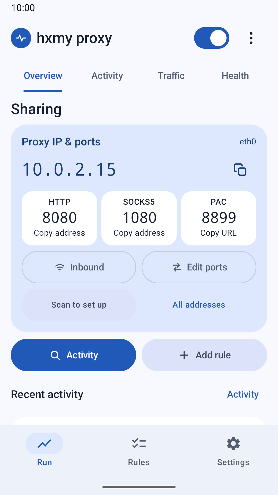
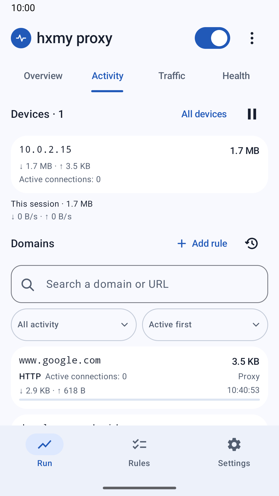
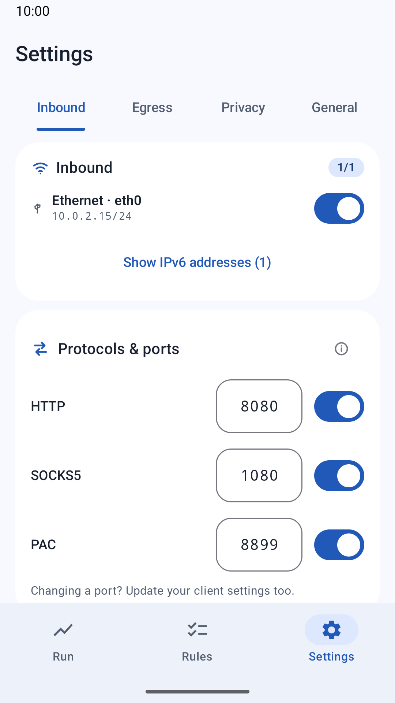
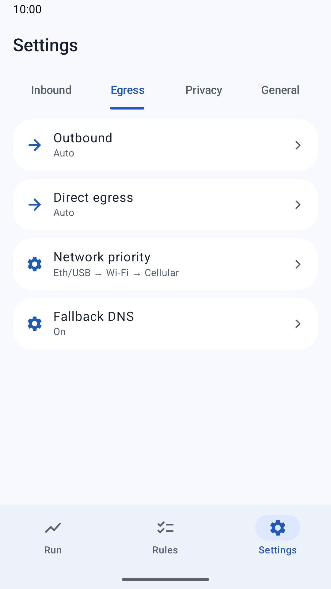

# hxmy proxy

> **English** · [简体中文](README.zh-CN.md)

**Use your Android phone as a local proxy gateway.** Connect a laptop, tablet or another phone
through HTTP / HTTPS CONNECT, SOCKS5 TCP or PAC. Choose the phone's outgoing network, see which
devices are using it, and inspect destination traffic when a website stops working.

The app runs a proxy on your phone; it does not provide its own VPN service. A compatible VPN
already running on the phone can serve as an outgoing network. Each client must be configured
to use the proxy. Apps that ignore proxy settings, UDP traffic and connections that bypass the
gateway are outside its coverage. VPN app policies and the local network can affect compatibility.

## Download and latest update

[**1.49.16 — Android APK**](https://github.com/wresource/hxmy-proxy/releases/download/v1.49.16/hxmy-proxy-1.49.16.apk) ·
[Release notes and AAB](https://github.com/wresource/hxmy-proxy/releases/tag/v1.49.16) ·
[What's new](docs/releases/1.49.16.md)

This release makes large rule lists easier to import, browse and search, fixes the large-TXT
import crash, and shows whether saved rule changes have actually taken effect. Failed updates
retain the previous complete rules and offer retry; when new Direct/Block protection cannot load
and no previous protection is active, sharing stops instead of continuing unprotected. Install
the APK over the existing app to retain its data. The AAB is for Google Play submission.
Availability on Play follows its own rollout.

| Overview | Device and destination traffic | Inbound and ports | Outbound settings |
|---|---|---|---|
|  |  |  |  |

Screenshots show the signed 1.48.76 app on an isolated emulator with controlled test traffic.

## First connection

1. Put both devices on a reachable local network: Wi-Fi, a phone hotspot, USB tethering or Ethernet.
2. Select the intended **Inbound** network in hxmy proxy and enable sharing with the top switch.
3. Use the IP address and protocol port shown in **Run → Overview**. **Edit ports** and **Inbound** are directly
   beside the connection information. The QR code opens setup instructions; scanning alone does
   not change the client's network settings.
4. Set the client's manual proxy or PAC URL. On supported Apple devices, review and install the
   generated Wi-Fi proxy profile in system settings. Other clients can use the manual instructions.
5. Open a website on that client, then check its new connections and traffic under **Activity**.
   “Sharing” means the phone's service is running; confirm the website result on the client.

After stopping sharing or leaving this network, disable the client's proxy or remove its profile
if it is no longer needed. A client still pointing to a stopped gateway may be unable to connect.

## The workbench

| Area | What you can do |
|---|---|
| **Run → Overview** | See IP addresses and HTTP/SOCKS5/PAC ports, copy or scan connection information, select Inbound and edit ports. Use the sharing switch, open client setup, or jump to Activity and Add rule. |
| **Activity** | See client devices and their upload/download usage, destination traffic, active connections, recent results and the effective rule. Search or sort, open the full domain list from its five-row preview, and inspect a destination without losing context. |
| **Traffic / Health** | Inspect usage by period and outgoing network, service health, latency, protection, history and diagnostic logs. |
| **Rules** | Add or import domain/IP/CIDR/range rules, preview conflicts, and browse or search large lists page by page. Manage built-in groups, editable copies and subscriptions; review recent changes and the actual application status. |
| **Settings** | Inbound and ports are directly editable. **Outbound** and **Direct egress** remain separate. Configure protocols, DNS, authentication, performance, appearance, diagnostics and backups. |

The main navigation has Run, Rules and Settings. Overview, Activity, Traffic and Health are sections
within Run; detailed lists and settings open separate pages or bottom sheets.

## Import and manage rules

Open **Rules → Import** to select a TXT file or paste entries. Check the preview and invalid
lines before appending to a list or confirming replacement. IPv4, IPv6, CIDR and same-family
address ranges are supported: `1.2.3.4-1.2.3.255` and `1.2.3.4 1.2.3.255` both mean a range.
Ranges become equivalent CIDR blocks without expanding every address.

List previews show five entries; the full page loads and searches 50 at a time. Built-in lists
can be browsed, searched, exported or copied into an editable list. Overlap warnings identify
the relevant rule or group, with options to inspect, disable it or keep the new rule. IP/CIDR
rules match IP-address requests; they do not automatically reroute hostname requests by their
resolved IP. Any related-IP hint uses an observed connection, not an assumed DNS result.

## Routing and troubleshooting

- **Proxy** uses the configured Outbound path. **Direct** uses a physical network independently
  of the VPN. If a pinned Direct egress network is unavailable, the request fails instead of
  silently switching to the VPN. With no Inbound network selected, incoming clients are denied.
- Rules accept domains, IP addresses and CIDR. `example.com` includes all levels,
  `*.example.com` matches one subdomain level, and `=example.com` is exact. Scope controls reach,
  not priority. More deeply anchored rules win; equal anchors use their established recency rules.
- Domain filtering depends on the hostname supplied to the proxy. An IP-only request can be
  matched by IP/CIDR; the app cannot promise to recover every hostname from encrypted traffic.
- When a site fails, search Activity, inspect the recorded result and effective rule, and make the
  smallest appropriate change. **Proxy** and **Direct** have different effects. DNS or an unavailable
  network may need a network setting change instead of a new rule.
- Check the rule application status after editing. Saved settings and active rules are distinct.
  On a failed update, a complete previous rule table stays active and the app offers retry and
  logs. If new Direct/Block protection fails with no previous protection, sharing stops and
  existing connections close. Resolve the error and explicitly start sharing again. A deliberate
  empty configuration remains valid; incomplete startup rules never open proxy listeners.
- Retry on the client and observe a **new** connection. Saving a rule does not rewrite old records
  or prove that the website works. The latest 20 quick rule changes are retained locally across
  restarts; restore is blocked if later edits changed the same host, even if it was changed back.
  Clearing this history keeps the active rules.

Other capabilities include per-entry rule switches, built-in app/service groups, ad/tracker
lists, HTTP/SOCKS authentication, IPv4/IPv6 ingress, DNS fallback, adjustable connection limits,
cross-session traffic totals, link probes and a non-blocking TCP relay. Sharing can resume after
an update or reboot when it was previously active, subject to Android's background restrictions.
An intentional stop or a rule-protection safety stop keeps it off.

## Privacy and local data

No account, advertising SDK or usage analytics SDK is included. Settings, traffic summaries,
recent rule changes and diagnostic logs are stored on the phone. Android automatic cloud backup
is disabled; proxy credentials are stored separately and are excluded from settings exports.

Network access is part of the app's function: it forwards client traffic to destinations, resolves
names using the configured path, downloads enabled subscriptions and runs requested diagnostics.
Backup DNS can use Google, Cloudflare, Alibaba or Tencent services. These providers and the chosen
network/VPN process their respective requests; “local storage” does not mean no network requests.

Settings backups can contain rule domains and recent change history. Diagnostic exports can
contain destination names, client IPs and connection details. Exports leave app storage only when
you choose a file destination or sharing recipient, which may itself be a cloud service. There is
no automatic log upload. The diagnostic switch, traffic-history reset and rule-history clear are
separate controls; disabling logs does not erase your rules or settings.

## Development

Android 10+ (`minSdk 29`, `targetSdk 37`), Kotlin, Jetpack Compose and Material 3.
Package: `com.mzstd.hxmyproxy`; publisher: **mzstd**.

The version in `app/build.gradle.kts` describes this checkout, not necessarily the version currently
published on Google Play. Release builds require the project's signing configuration; without it,
Gradle produces an unsigned APK. Do not replace an installed release with a differently signed
build by uninstalling it if you need to keep its data.

```sh
./gradlew :app:testDebugUnitTest :app:assembleDebug :app:assembleDebugAndroidTest :app:assembleRelease :app:bundleRelease
```

Instrumented tests require an explicitly selected, isolated test device. Debug-only controlled VPN
fixtures are excluded from release. Local tests establish the exercised scenarios; they are not
production Android vitals or proof of compatibility with every VPN and physical network.

Historical architecture and version notes are retained in the [Chinese README](README.zh-CN.md)
and local `version-md/` records. Older benchmark results apply to the documented versions only.

## License

Copyright (C) 2026 wresource. Licensed under the **GNU Affero General Public License v3.0**;
see [LICENSE](LICENSE) for the complete terms. Distributed without any warranty.
