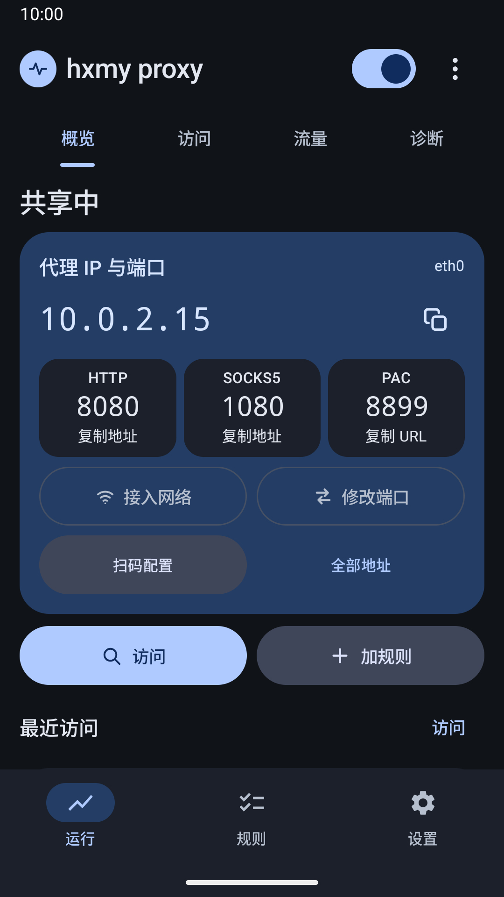
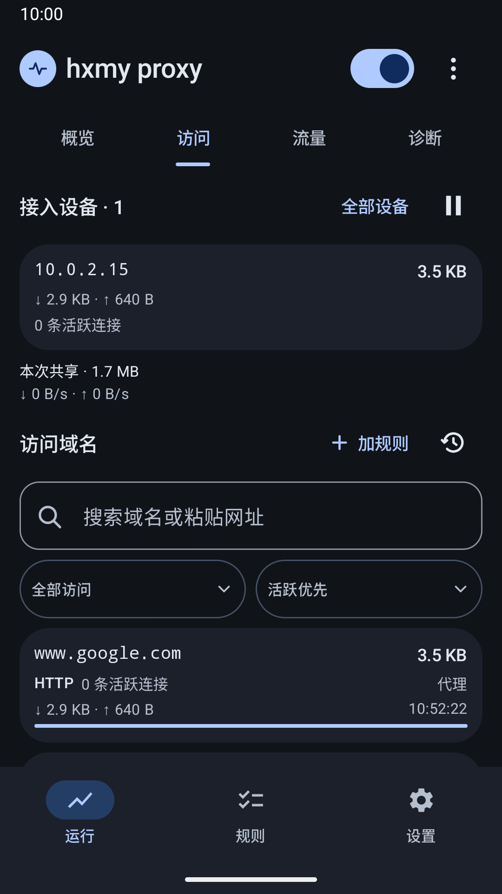
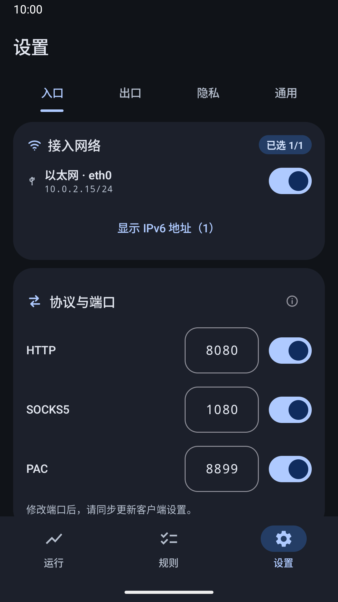
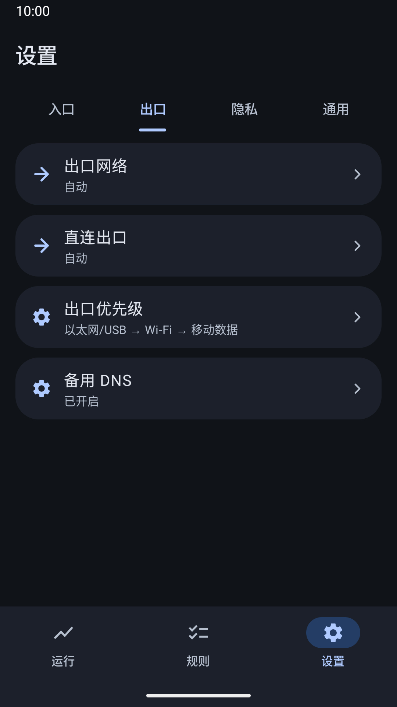

# hxmy proxy · 应用综合总览

> [English](README.md) · **简体中文**

**把 Android 手机作为本地代理网关。** 电脑、平板或另一台手机可通过 HTTP / HTTPS CONNECT、
SOCKS5 TCP 或 PAC 使用手机的出口网络；在工作台直接查看接入设备、每台设备的用量及目标域名流量，
访问异常时检查原因、修改规则并观察新的连接。

Android 10+（minSdk 29 / targetSdk 37），包名 `com.mzstd.hxmyproxy`，开发主体 **mzstd**。
当前源码版本以 `app/build.gradle.kts` 为准，不代表 Google Play 已发布该版本。

## 下载与本次更新

[**1.49.16 · Android APK**](https://github.com/wresource/hxmy-proxy/releases/download/v1.49.16/hxmy-proxy-1.49.16.apk) ·
[发布说明与 AAB](https://github.com/wresource/hxmy-proxy/releases/tag/v1.49.16) ·
[完整更新内容](docs/releases/1.49.16.md)

本版重点改善规则导入、完整浏览与搜索，修复大 TXT 导入闪退，并明确区分“已保存”和“已生效”。
规则更新失败时保留旧完整规则并提供重试；没有旧直连/拦截保护、又无法加载新保护时，停止共享，
避免继续无保护转发。APK 可直接覆盖旧版保留数据，AAB 用于 Google Play 提交；Play 上线时间以商店为准。

| 运行概览 | 设备与域名流量 | 接入网络与端口 | 出口设置 |
|---|---|---|---|
|  |  |  |  |

截图来自1.48.76正式签名应用，数据为独立模拟器内的受控测试流量。

## 1. 适用范围

应用运行本地代理，不自建 VPN 服务。手机上兼容的 VPN 可以作为出口，但 VPN 应用策略和本地网络
会影响可用性。**每台客户端都要配置代理**；忽略代理设置的应用、UDP 和绕过网关的连接不在覆盖范围内。

- 有 VPN：已配置代理的客户端可复用手机上的兼容 VPN 出口，无需各自安装 VPN。
- 无 VPN：仍可使用手机的物理网络出口，并对实际经过代理的连接应用规则与统计。
- 支持 Wi-Fi、手机热点、USB 网络共享或以太网等可达的本地连接；不承诺任意网络都允许客户端互访。

域名规则依赖客户端向代理提供的主机名。只有 IP 的请求可按 IP/CIDR 匹配，不能保证从所有加密流量中
还原域名，也不能把它描述成自动接管整个局域网的过滤器。

## 2. 第一次接入与日常排障

1. 让客户端与手机位于相互可达的本地网络，在 **Inbound** 中选择接入接口。
2. 用首页顶部的左右开关开启共享。首页直接显示 IP 和 HTTP/SOCKS5/PAC 端口，旁边可编辑端口和接入网络。
3. 打开客户端的代理设置，填写对应地址或 PAC URL。二维码打开接入说明，**扫码本身不会修改客户端设置**。
   支持的 Apple 设备可以下载 Wi-Fi 代理描述文件，核对后在系统设置中安装；其他设备按说明手动配置。
4. 在客户端打开网站，再到“访问”查看新连接和流量。“共享中”表示手机服务在运行，网站是否可用仍以客户端结果为准。
5. 停止共享或离开该网络后，不再需要代理时应在客户端关闭代理或移除描述文件，避免继续指向已停止的网关。

网站打不开时：搜索目标域名 → 查看这次连接的结果和命中规则 → 做最小必要修改 → 客户端重试 → 观察新连接。
“走代理”和“直连”含义不同；DNS 失败、指定网络离线应检查对应设置，不能一律通过添加放行规则解决。

## 3. 工作台与功能入口

| 区域 | 内容 |
|---|---|
| **运行 → 概览** | 常驻共享开关、IP/协议/端口，复制与扫码就近；Inbound、编辑端口、访问和添加规则直接进入。 |
| **访问** | 接入设备及每台上下行用量，域名累计流量、活跃连接与访问结果；搜索、排序、暂停查看。域名摘要先显示5行，完整列表进入单独页面；详情保留上下文。 |
| **流量 / 健康** | 按时段和实际出口统计用量，查看连接质量、权限和端口状态，以及防护、历史和日志。 |
| **规则** | 常驻添加/导入，支持域名、IP、CIDR及IP范围；大列表分页浏览搜索，显示覆盖冲突和实际生效状态。保留内置组、可编辑副本、订阅、独立启停及近期修改恢复。 |
| **设置** | 入口栏直接编辑接入接口与端口；Outbound 与 Direct egress 独立保留。其他栏目提供协议、DNS、认证、性能、外观、诊断及备份。 |

主导航为运行、规则、设置；概览、访问、流量、健康是运行页内的栏目，完整列表和细项按需要打开单独页面或底部面板。
不推测不存在的数据关联：客户端用量与域名用量分别展示，累计流量、单条连接流量与实时速率分开标注。

规则文件可从 **规则 → 导入** 直接选择或粘贴，先查看预检及错误行，再追加或确认替换。
支持 IPv4、IPv6、CIDR，同一行 `1.2.3.4-1.2.3.255` 或 `1.2.3.4 1.2.3.255` 均按起止范围处理，
转换为等价 CIDR，不逐个展开地址。摘要先显示5条，完整页面按50条查询；内置大表可完整浏览、搜索、
导出或创建可编辑副本。覆盖冲突会定位到具体规则或组，可查看、停用或保留继续。
IP/CIDR匹配的是请求中的IP字面量，不自动根据域名解析IP改变分流；关联提示只使用实际连接证据。

## 4. 行为与实现约定

- **规则**：`example.com` 全层级、`*.example.com` 单级、`=example.com` 精确。作用域决定覆盖范围，
  不是优先级；更深锚点优先，同一锚点保留既有的时序裁决。编辑保留原条目的创建时间，停用不等于改成相反动作。
- **规则生效**：保存后查看“正在应用 / 已生效 / 应用失败”。失败时保留旧完整规则，提供重试和日志；
  没有旧直连/拦截保护而新保护加载失败时，停止共享并关闭已有连接，修复后须手动重新开始。
  有意保持空配置仍可使用；初始规则加载不完整时不会开放监听。停止后旧重试不能重新开启共享。
- **出口**：Proxy 使用 Outbound；Direct 使用独立的物理网络。固定 Direct egress 不可用时拒绝连接，
  不偷偷回到 VPN。Inbound 没选接口时全部拒绝，收缩准入也会清理不再允许的在途连接。
- **安全恢复**：快捷修改与其前后快照同一 DataStore 事务保存，最多20条。本域名后来被编辑过时，
  旧记录不能覆盖后续修改，即使后来又改回相同值；无关域名和端口不受撤销影响。清空记录不改变生效规则。
- **网络与服务**：HTTP/CONNECT、SOCKS5 TCP、PAC，IPv4/IPv6 入站，NIO 转发及背压统计。
  系统 DNS 主路失败后按配置提供互援与 DoH；服务以 connectedDevice 前台通知运行。
- **恢复共享**：上次正在共享时可在更新/重启后尝试恢复，仍受 Android 后台限制；主动停止或规则保护失败而停止后保持关闭。
- **界面**：Jetpack Compose + Material 3，中英文、浅深色、宽屏和大字体；复杂详情统一底部面板。
- **历史性能资料**：本地`version-md/proxy-benchmark-2-1.2.10-vs-every.md`针对当时版本与测试环境，
  不是当前版本在所有设备上的性能承诺。本地受控 VPN 测试也不等同实体网络、商业 VPN 或线上 Android vitals。

## 5. 隐私与数据

无账号、广告 SDK 或使用分析 SDK。设置、流量摘要、近期规则修改和诊断日志保存在本机；
`allowBackup=false` 关闭 Android 自动云备份，代理凭据单独加密保存且不包含在设置导出里。

应用会为其功能访问网络：转发客户端请求、解析域名、下载启用的订阅和执行用户请求的诊断。
备用 DNS 可使用 Google、Cloudflare、阿里或腾讯服务；请求会经过所选网络/VPN 到达对应服务。
“本地保存”不能解释为“不访问外部网络”。

用户主动导出的设置可包含规则域名与最近修改记录；诊断日志可包含访问域名、客户端 IP 和连接详情。
这些文件按用户选择写入文件位置或交给分享对象，目标也可能是云盘。应用没有自动上传日志的功能。
日志总开关、流量历史清空和规则修改记录清空分别控制对应数据；关闭日志不会删除规则和设置。

开发验证需使用明确选定的隔离设备；Debug 专用 VPN 夹具不进入 Release。正式升级应使用原签名，
不要通过卸载旧版来绕过签名冲突，否则会丢失本地数据。以下为保留的**历史版本资料**，不表示当前页面结构或验证状态。

## 6. 版本演进（关键里程碑）

- **1.0–1.1.x**：V1 基线（四屏、代理核心、mDNS→后移除）+ 打磨加固（日志降噪、端口重试、Splash、Baseline Profile）。
- **1.2.x**：relay NIO 非阻塞；蜂窝/热点场景改进；换 Wi‑Fi 中断根因修复；PAC 展示链路 + 移除 mDNS。
- **1.3.x**：UI 蓝粉→Candy Azure 配色重构。
- **1.5.x**：内置规则 64 组；预测性返回根因修复 + 延迟逐格刷新 + 青春配色；UI 一致性打磨 + 抽 4 共享组件。
- **1.6–1.8.x**：规则系统 reject/bypass 双模块重构 + CIDR + per-host 三态覆盖；独立防护 tab（拦截明细 + 三态救济）；
  首页双状态 tile + 三态；全面中英双语打磨（扫码页/横屏按钮/图标）；
  **准入 fail-closed**（不选网段=全拒 + 在途清扫）；**DNS 三层防线 + DoH 备援**。
- **1.9.0**：**出口网络选择器**（Auto/VPN/Wi-Fi/蜂窝/以太网-USB，代理出站可选走哪张网，per-socket 绑定）。
- **1.10.x**：Bento UI 定稿 + 六页重构；换网每 3 秒 refresh 风暴消除；DNS 连接超时 8→2.5s + DoH 并入 Happy Eyeballs 竞速。
- **1.11–1.13.0**：DIRECT **fail-closed** 防泄漏 VPN + arxiv 长连接卡顿修复；**Apple/App Store 直连组**（64→65 组）+
  监控页 override 徽章即时显示；**多出口**（蜂窝免权限检测）+ **直连出口独立配置**（AUTO=以太网→WiFi→蜂窝）+ 出口卡全宽；
  规则集**分类/全部一键批量开关** + 快速拦截总开关。
- **1.14.x**：规则条目**带启用状态**（`Set<String>`→`List<RuleEntry>`，DataStore 转 JSON + 旧数据平滑迁移；停用=不进匹配表、**不切反面**；小开关操作 + Active/Off 状态标；启用按添加序在前、停用按最近停用在前）；
  **目标域名独立详情页** + 点域名统一写入 block/allow 规则（互斥自动移）；域名标改用 `RuleEngine.decide` **实时完整判定**（规则一变即重判，修「移除规则仍显示直连」的陈旧缓存）。
- **1.14.4–1.14.6**：**开机 / app 更新后自动恢复共享**（`RestartReceiver` 监听 `BOOT_COMPLETED`/`MY_PACKAGE_REPLACED`，
  仅当上次确实在共享中才拉起，主动停止即清零）。修「装新版后须手动重开」——那段空窗里客户端连不上监听端口，
  浏览器会把该代理标记 bad proxy 并退避 5 分钟（该状态在浏览器进程内、app 无法清除）。
  同期打开拒连黑箱（准入拒绝此前完全静默、上限拒绝只进 logcat），并补上热重启路径缺失的 `registry.reset()`。
- **1.15.0–1.16.0（隐私收口）**：日志目录改 `noBackupFilesDir` 且 **关闭系统云备份**（`allowBackup=false`）——
  此前日志落在 Auto Backup 默认包含范围内，含访问域名的 `app.log` 会被上传，与「完全本地」的承诺字面冲突；
  release 版用 R8 剥离 logcat 的 v/d/i（正式版不再向系统日志输出域名与客户端 IP）；日志容量 512KB→10MB
  （原容量保底仅约 4600 行，一次失败风暴几小时即冲掉崩溃栈）。因云端恢复被主动关掉，新增
  **设置导出/导入 JSON**（遍历 DataStore 键值 + 类型标记，新增设置项自动进备份）承担换机迁移。
- **1.17.0（可观测性重构）**：结构化事件门面 `Ev`（`evt=… k=v`，tag 位改为 13 个子系统分类，可按子系统 grep）；
  **`key.log` 独立环**——生命周期/准入/拒连/崩溃镜像写入，永不被高频日志冲出滚动窗口；常驻 BufferedWriter
  替代每条 open/write/close；统一节流并补报 `suppressed=N`；`RuleEngine.decideDetailed` 返回**命中来源**
  （回答「某域名为什么被拦/为什么走直连」）；诊断日志总开关。
- **1.18.0**：**段① 客户端→本机链路时延**（此前只测本机→互联网，而手机当网关时最先劣化的恰是段①，
  于是「手机自己正常、连它的设备却卡死」在 UI 上毫无线索）。ICMP 优先、TCP-RST 兜底，10 秒一次且仅在有
  在线客户端时探；p50 主数字 + p95 小字，按阈值着色。同时修 `LatencyProbe` 两个真 bug：DNS 被算进延迟、
  探针未绑定用户选定的出口网络。
- **1.18.1–1.18.5（排障仪表与自愈）**：第三次「手机自己正常、客户端连不上」故障复盘暴露出仪表盲区——
  故障起止时刻、SYN 到没到手机、app 层活没活着，在导出日志里**完全同形不可判**。补齐判定链：
  **60s PERF 心跳**（端口/连接/accept 累计/生效准入/RSSI/链路，每 10 分钟一条镜像进 key.log）、
  **accept 成功落盘**（区分「没连上来」与「连上来了」）、**127+LAN 配对自探**（状态翻转才落盘，
  区分 app/内核与无线/对端两个世界）、**LinkProbe 失败落盘**（`linkprobe.lost/recovered`，
  判「手机→客户端」方向）、accept 异常统一落盘+退避（消除零日志 CPU 自旋盲区）。
  **NIO relay 反应堆韧性**：selector 线程崩溃从「零日志+新隧道永久挂起」改为落 key.log + 按槽自动重建
  （5s 冷却），垂死窗口 TOCTOU、复活构造失败、stop 与线程池回收的竞态全部闭合。
  **手动刷新服务**（共享中 hero 卡右上）：app 全量重置 → 主动探测最近客户端（刷沿路 ARP/转发表项）→
  仍不通则引导拉起系统网络面板（app 无权开关 WLAN），结果落盘为现场判定。
  修复：停止→立刻开始的「假共享」窗口（`started` 残留 + 无参 `stopSelf`）、权限回调 pending-result
  跨进程重投导致的「重开 app 自动续上」、refresh 日志假 fail-closed 误报（改打实际生效值 + `kept` 标记，
  scanKey 带接口名与类型）、零计账字节连接被 ageOut 秒删（监控漏显瞬时客户端）。
  准入安全：回退开发中曾放行的 loopback（会打破「不开=全拒」并暴露免认证代理面），
  自探改**源端口标记**识别、不再误伤本机自用代理的记账。
- **1.19.0–1.19.1（路径保活三层）**：把「客户端连不上」从被动排障推进到主动自愈。
  ① **15s 存在通告**——向各入口子网发定向 UDP，手机主动出向的每个单播帧都携带自身 IP+MAC，
  持续刷新沿路路由器/AP 的转发表(换频段或重关联后转发表不收敛的坏窗口被压到秒级)；
  ② **跨会话客户端记忆**——最近客户端落盘，会话第一秒就有探测目标(最需要被探的恰是本会话还没连上来的那台)；
  ③ **失联检测与自愈**——`sawInbound + 90s 静默 + 连续 3 次探测失败 + 自探正常` 四条同时成立才判失联，
  自愈突发带单飞与冷却、最多 3 轮。
- **1.19.2–1.19.3（广告表误杀救济）**：公共黑名单(oisd，自动聚合)会误收厂商的**内容分发域名**，
  叠加「广告表优先于 App 直连组」的判定顺序，结果是「功能坏了但看不出为什么」
  （实测微信小程序打不开、图片转圈，根因是 `wxa.wxs.qq.com` 被拦 41 次）。新增**救济表**：
  命中则跳过广告表、继续按 App 组走，位置在用户手动规则之下。556 条冲突全量人工分诊，净增 50 条，
  每条都有客观依据(DNS CNAME 链 / 厂商文档 / 实测)，存疑一律不收。
- **1.20.0（规则作用域三档）**：写法决定管多深——`apple.com` 全层级 / `*.apple.com` 单级 / `=apple.com` 精确；
  **档位只定作用范围、不定优先级**：冲突按**锚定深度**裁决(`xxx.apple.com` 胜过 `apple.com`，
  否则「6 月图省事加的宽规则」会无声抹掉「1 月精心加的窄规则」)；锚定同一域名的几条平手，由最近设定的那条决胜；
  UI 给三档 chip + 条目徽标，选「全层级」时弹确认防误填。
- **1.20.1（计量口径与日志可读性）**：一次「共享」= 一个计量周期，开始/停止两端收敛到唯一语义边界
  （散着写漏一处就表现为「重开共享把上次流量接着算」，而这种错只有用户能发现）；日志详情按内容溢出判定
  可展开、支持按级别(I/W/E)过滤。
- **1.21.0（历史流量统计）**：跨会话按「时段 × 出口 × 上下行」记录并落盘——今日/本周/本月/今年/总计，
  出口分 VPN 隧道 / Wi-Fi / 蜂窝 / 以太网，**蜂窝单列一格**(唯一要花钱的一档)。与首页那个「本次共享」的
  Total 是两个口径，UI 上分别标注周期避免打架。出口归类做在建连层(只有那里知道**降级之后**真正走的是哪张网)，
  **VPN 必须先判**——系统 VPN 的 capabilities 同时带底层物理 transport，先判物理会把隧道流量记成 Wi-Fi 直连。
  三层桶：小时(8 天，服务「今日」24 柱) / 天(730 天，周月年由它累加) / 永久累计器(总计的权威值)。
  只提供手动清空，不做任何自动清理。同版顺带把全 app 的字节格式化统一为 1024 进制
  （此前同一笔流量在两处显示 `1.8 kB` 与 `1.7 KB`）。
- **1.22.0–1.22.2（诊断第二梯队）**：**进程死因归因**——重启后从系统侧取回上次的死因
  （低内存 / 崩溃 / 被系统杀），并配一张 128 字节的**状态纸条**：常规日志的缓冲写在 `SIGKILL` 下会连同
  最后几秒一起丢失，而这张纸条由系统保管、必然存活，于是「死之前在干什么」有了下限保证。
  `isLowMemoryKillReportSupported()` 必须一并落盘——不支持上报的设备会把内存杀报成
  `SIGNALED`+SIGKILL，不记这一位就会把「被内存杀」误读成「被信号杀」，而两者的处置方向相反。
  同批补 6 处诊断事件（规则资产装载失败 / 规则重建规模 / 反射 fd 回退 / 出口回调注册失败 /
  evict 汇总 / bind 失败）。另修一个真 bug：接口周期重扫曾被「仅蜂窝上行时」限制，而共享类接口
  （USB / 热点）**没有 `NET_CAPABILITY_INTERNET`**、不被系统当作默认网络变化上报，
  于是 Wi-Fi 上网时插 USB 永远发现不了——**回调覆盖不到的东西，周期重扫是唯一兜底**。
- **1.23.0（背压归因）**：同样是「慢」，瓶颈可能在两端的任一端。按方向分别计 relay 每条隧道的
  **阻塞时长**：`drain()` 写不完（对端发送缓冲已满）即进入阻塞态，下行阻塞＝入口段扛不住
  （手机 → 客户端那一跳），上行阻塞＝出口段慢。只在**状态翻转**时取 `nanoTime`（不是每次 drain 都取），
  隧道关闭时补结算未闭合的那段，心跳报时长加权占比与极值；无隧道结束时整组字段省略，不打 0% 噪音。
  有意**没做**「单条隧道超阈值额外落盘」：不先看真实分布就定阈值，等于造一个看着精确、实际是噪音的数字。
- **1.24.0（规则条目可编辑）**：自己加的域名 / IP 点进去能看全、能改写、能换作用域档位，不必删了重加
  （长 IPv6 与 CIDR 在列表里会被截断，而「想改一个字符」此前只能整条删掉重来）。改写**保留原 `addedAt`**——
  锚定深度相同的规则平手时用它决胜，重置了会静默改变裁决结果，这种错不会报错、只会让规则
  某天开始不按预期生效。
- **1.24.1（发布链路维护）**：三条来自 Play Console 的告警,处置各不相同。
  ① **native 符号**：产物里的 `.so` 全部来自 AndroidX（本项目无 NDK 代码），补 `debugSymbolLevel = "FULL"` 让符号进包。
  ② **deprecated `setStatusBarColor`/`setNavigationBarColor`**：**修不掉,也不该修**——我们一次都没调过，
  真实调用点是 `androidx.activity.EdgeToEdgeApi29.setUp`；查最新 androidx-main 源码，**每个** EdgeToEdge 实现
  （含最新的 `EdgeToEdgeApi35`）都要设这两个属性。Play 另一条告警恰恰建议「调用 `enableEdgeToEdge()`」——
  而它的实现方式就是被告警的那个 API，**两条建议自相矛盾**。向后兼容分支必须保留，静态扫描必然报。
  ③ 顺带把 **activity 1.8.2 → 1.13.0**（落后两年半）。升级后在 API 36 上实测三条路径无回归：
  浅色基线像素级一致、系统深色配置变化、**app 内切主题而系统不变**（后者靠 `DisposableEffect(darkTheme)` 手动重调，
  是升级最可能打破的一条）。
  同版修一个隐患：release 曾写死 debug 签名，现改为从 `keystore.properties` 读，缺失则**不签名**——
  宁可拿到装不上的未签名包，也不要拿到「看着能用」的错签名包（它传不上 Play，装真机还会因签名不同要求先卸载、连带丢设置与日志）。
- **1.24.2–1.24.5（测试基座）**：`androidTest` 此前**整体编译不过**、11 个文件 0 个能跑，已持续 6 天——
  日常构建碰不到它（assembleDebug 与 testDebugUnitTest 都不编译 androidTest），所以发版全程绿灯。
  修完后逐条处置：cleartext 未放行 loopback（8 个端到端用例跑不起来）、端到端测试因参数默认值
  测的是**生产不走的旧阻塞 relay**、启动屏与 Compose 测试规则**互相死锁**（放行条件要等被自己拦住的
  绘制去驱动，实测挂死 7 分钟——顺带给启动屏加了 2s 上限，那是防白屏的产品兜底）。
  随后补测 419 个单测（逻辑层覆盖率 54.7%），并加了两个自助脚本 `scripts/test.sh` 与
  `scripts/coverage.sh`：失败直接打异常首行、覆盖率分模块比基线。
  期间还修了脚本自身一个要命的缺陷——gradle 编译失败时它去读**上一次**的报告，报出「全部通过」；
  发现它靠的是「加了 7 个用例但数字没变」。
- **1.24.6（设置扇出）**：改一次设置不再全量重建 61063 条规则。实测「只改主题」耗时 **1124ms**，
  因为 `SettingsRepository.settings` 没有 `distinctUntilChanged`，而下游对**任何**一帧都做
  applyTunables + 规则重建 + refresh。加去重 + 按 9 个规则字段记忆化早退（`@Synchronized`，
  否则 stop→start 竞态会把 memo 永久毒化成静默陈旧规则）；顺带把 `toSettings()` 里 5 次
  org.json 解析用 `flowOn` 挪出主线程——那才是「改主题界面顿一下」的直接来源。
- **1.24.8–1.24.10（真机日志驱动）**：来自 5 天 32463 行日志的四项改进。
  ① **直连不通的域名在防护页现形**：237 次 DIRECT 超时全是被用户设成「直连」的遥测域名——
  用户点「允许」时想要的是「别拦它」（=走代理），而「直连」是**绕过 VPN**，两者结果常常相反；
  而 DIRECT 是 fail-closed 的，失败对用户完全静默、只表现为「有时候卡」。现在列出来并可一键改回。
  ② 三态弹窗给出每个选项的**后果**，「直连 + VPN 在线」用警示色。
  ③ **丢包率成为可见指标**：时延窗口只收成功样本，于是「p50 很漂亮但一半包丢了」完全看不出来
  （实测 p50 <20ms 占 34.8%，而自愈突发每 10 发只回 3~5 发）。超阈值给**物理层**建议。
  ④ 自愈突发有响应就早退（158 轮里 97% 有响应＝路径本来就通、只是丢包，再密集发包纯属耗电）；
  自探 `lan=fail` 被证实是**误报**——12 次每一次前面都紧跟一条「扫不到接口」的 refresh，
  自探拿着被保留的旧地址去连，却被注释解读成「内核入站被拦」
  ——当前版本（versionCode 130）。

## 7. 文档索引

历史技术子文档保留于本地 `version-md/`（不随源码发布）：设计入口 `v1-design.md` · 代理核心 `v1-proxy-core.md` ·
PAC/共享 `v1-pac-and-sharing.md` · 网络准入 `v1-network-and-admission.md` · 服务权限 `v1-service-permissions-compat.md` ·
架构/UI `v1-architecture-ui-state.md` · 路线 `roadmap.md`。

## 8. 许可证

Copyright (C) 2026 wresource

hxmy proxy 是自由软件，依据 **GNU Affero 通用公共许可证第 3 版（AGPL-3.0）** 发布，
全文见 [`LICENSE`](./LICENSE)。

简单说：你可以自由使用、研究、修改和再分发本软件，但**任何被你分发的衍生作品——
或以网络服务形式提供给他人使用的版本——同样必须以 AGPL-3.0 公开其完整源码**。
这条约束的目的是：一个隐私工具的每一个分支，都应当能被使用它的人审计。

本程序按「现状」分发，不附带任何担保；亦无对适销性或特定用途适用性的默示担保。
